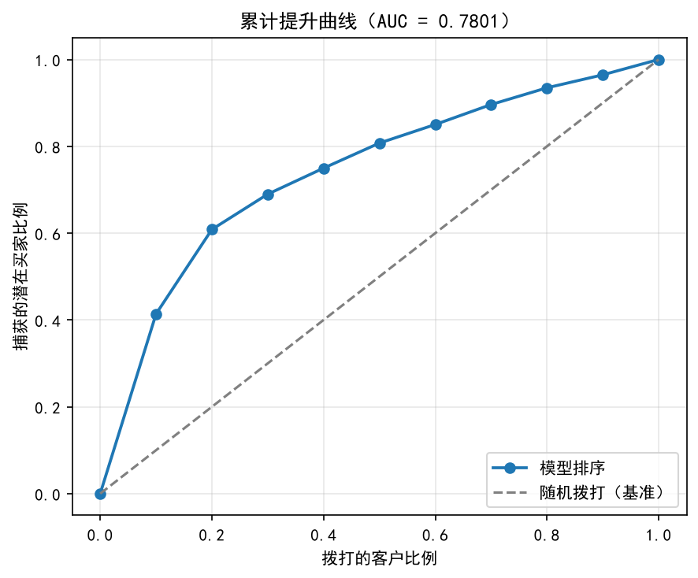

# 银行电话营销响应预测

用历史客户数据训练模型，预测「哪位客户更可能认购定期存款」，从而把外呼名单缩短、降低营销成本。

## 数据从哪来

UCI Machine Learning Repository — **Bank Marketing** 数据集（编号 222，公开、可复现）

- 数据来源：一家葡萄牙银行的真实电话营销记录，时间跨度 2008 年 5 月 — 2010 年 11 月
- 文件：`data/bank-additional-full.csv`
- 规模：41,188 行 × 21 列
- 目标列：`y` —— 客户是否认购定期存款（yes / no）
- 认购率约 11.3%（4,640 / 41,188）
- 许可：CC BY 4.0（可自由使用，需注明来源）

**官方页面**：https://archive.ics.uci.edu/dataset/222/bank+marketing

**引用**：

> Moro, S., Rita, P., & Cortez, P. (2014). Bank Marketing [Dataset]. UCI Machine Learning Repository. https://doi.org/10.24432/C5K306

**注意**：这是葡萄牙数据，经济变量为欧元区利率，不是中国银行数据。本项目验证的是「客户响应预测」的方法论，换数据源同样适用。

## 文件夹说明

```
data/        数据文件（原始 CSV + 字段说明）
notebooks/   分析笔记（Jupyter）
src/         可复用的 Python 脚本
figures/     画出来的图
```

## 怎么运行

1. 打开 Anaconda Prompt
2. 进入项目目录：
   ```
   cd "D:\DeepSeek Harness工作区\1\bank-marketing-response"
   ```
3. 启动 Jupyter：
   ```
   jupyter notebook
   ```
4. 打开 `notebooks/01_认识数据.ipynb`，从上到下依次运行

## 字段说明

| 字段 | 中文含义 |
|---|---|
| age | 年龄 |
| job | 职业 |
| marital | 婚姻状况 |
| education | 学历 |
| default | 是否有违约记录 |
| housing | 是否有房贷 |
| loan | 是否有个人贷款 |
| contact | 联系方式（电话/手机） |
| month | 最后一次联系的月份 |
| day_of_week | 最后一次联系的星期 |
| duration | 最后一次通话时长（秒） |
| campaign | 本次营销活动中联系过几次 |
| pdays | 距离上次联系过了多少天（999 = 没联系过） |
| previous | 之前联系过几次 |
| poutcome | 之前的营销结果 |
| emp.var.rate | 就业变化率（经济指标） |
| cons.price.idx | 消费者价格指数 |
| cons.conf.idx | 消费者信心指数 |
| euribor3m | 欧元区 3 个月利率 |
| nr.employed | 就业人数（千人） |
| y | **是否认购（目标）** |

## 进度

- [x] 环境搭建、数据下载
- [x] 认识数据（看行列、看认购率）
- [x] 画 3 张图
- [ ] 逻辑回归基线
- [ ] 调参、算提升度
- [ ] 做成网页、打包

## 分析发现

1. **整体情况**：一共 41,188 名客户，认购成功 4,640 人，认购率 11.3%（正负样本约 1:8）。
2. **职业差异**：认购率最高的是学生（31.4%），最低的是蓝领（6.9%）。但学生只有 875 人，占总体比例小，绝对贡献有限。
3. **通话时长**：通话越长，认购率越高，从 0—100 秒的 0.8% 飙升到 500 秒以上的 42.6%。但营销名单在通话前就要确定，通话时长是通话结束后才产生的数据，**不能作为预测特征**，否则会造成数据泄漏。

## 模型结果

| 模型 | 特征 | AUC | 说明 |
|---|---|---|---|
| **逻辑回归 + 标准化（最终选用）** | 19 个（已剔除 `duration`） | **0.7801** | 可解释性强，系数可直接解释 |
| 梯度提升树（HistGradientBoosting） | 同上，树模型不标准化 | 0.7937 | 高 0.014，但可解释性差 |
| 逻辑回归（含 `duration`） | 20 个 | 0.9348 | ❌ 数据泄漏，不可上线 |

**为什么最终选 AUC 更低的逻辑回归**：只差 0.014，业务价值差异很小；而银行场景需要解释「为什么给这个客户打高分」，逻辑回归的系数可直接给出理由，树模型需要额外用 SHAP 解释。指标与可解释性之间，选择了可解释性。

- 数据划分：训练集 32,950 条 / 测试集 8,238 条（8:2，`random_state=42`）
- 预处理：`StandardScaler` 在训练集上 `fit_transform`，测试集只 `transform`
- 评价指标用 AUC 而非准确率：正负样本约 1:8，全部判「不买」准确率就有 88.7%，但一个潜在客户都抓不到

## 业务价值（Lift 分析）

按模型给出的概率从高到低排序，看「只打前 X% 的客户能覆盖多少潜在买家」：

| 拨打比例 | 捕获买家比例 | Lift |
|---|---|---|
| 前 10% | 41.4% | **4.14** |
| 前 20% | 60.9% | **3.04** |
| 前 30% | 69.0% | 2.30 |
| 前 50% | 80.7% | 1.61 |

**结论：拨打名单缩短 80%，仍能覆盖 61% 的潜在买家**，外呼成本大幅下降。



### 踩过的坑

1. **特征泄漏**：`duration` 是通话结束后才产生的变量，而营销名单在通话前就要确定，必须剔除。
2. **标准化顺序**：先切分训练/测试集，再在训练集上 fit 标准化参数；测试集只 transform，不能重新 fit。
3. **训练与预测同源**：模型用标准化后的数据训练，预测时若喂原始数据，输出会全部饱和为 1，AUC 直接掉到 0.5。
